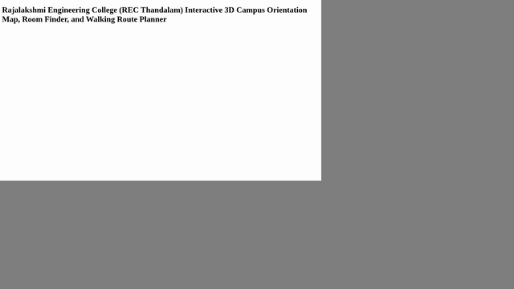
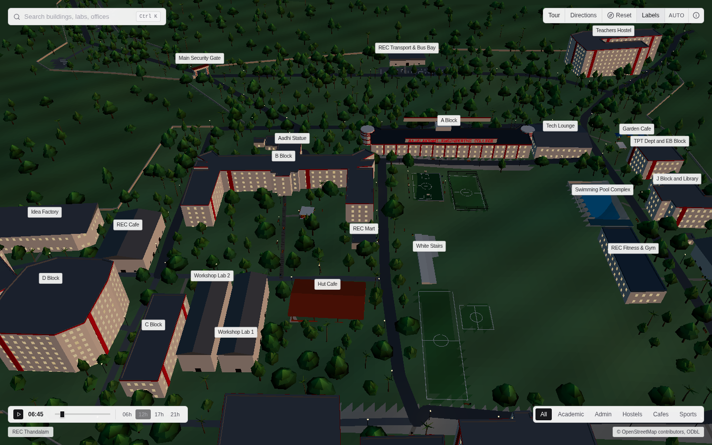
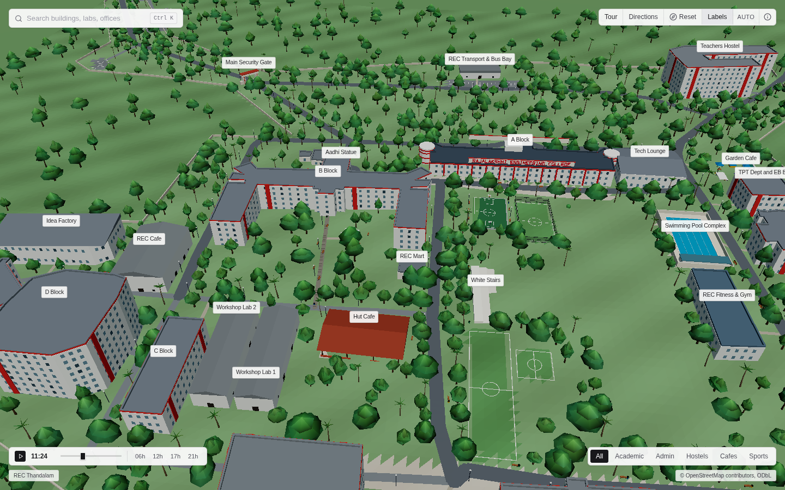
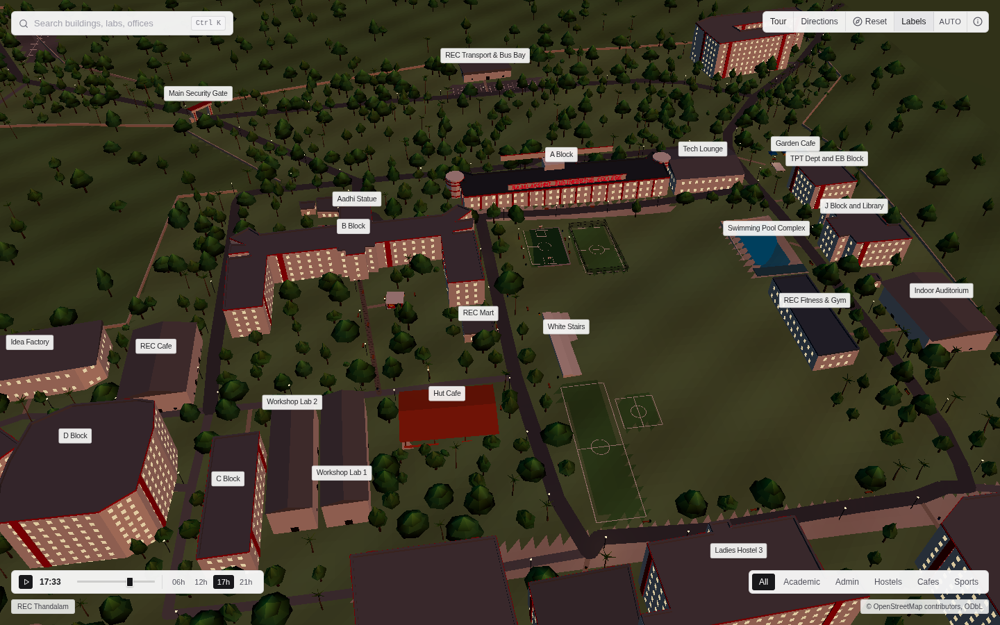
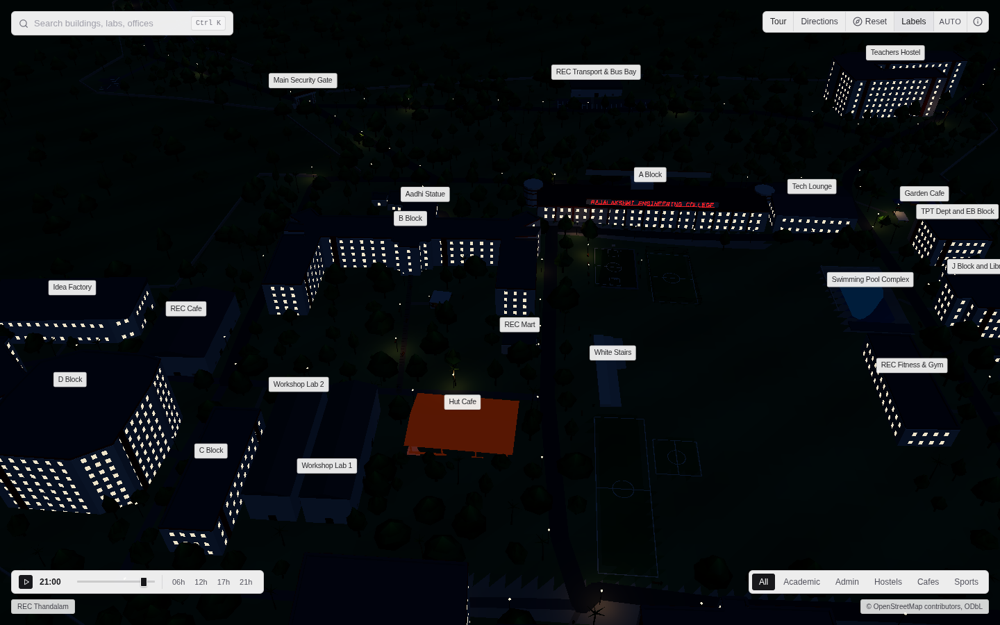
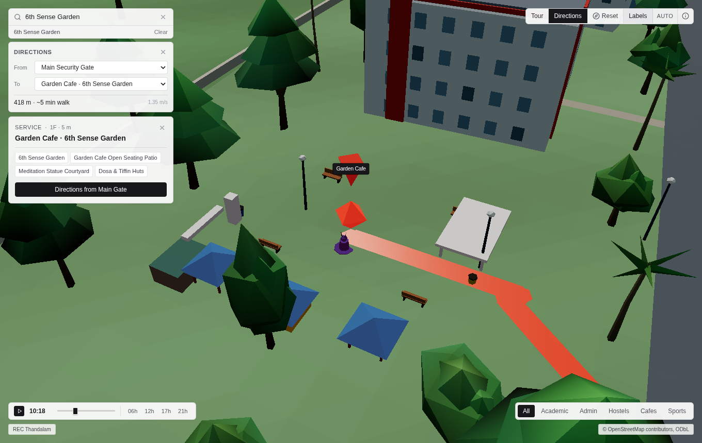
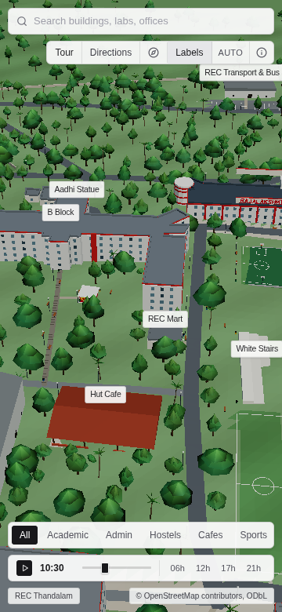

# REC 3D — Rajalakshmi Engineering College (Thandalam)

An interactive, architectural 3D campus map and standalone **Blender 3.6 / 4.x scene generator** for **Rajalakshmi Engineering College (REC), Thandalam, Chennai** (`13.0088° N, 80.0036° E`).

Built with **Vite + React + TypeScript**, **Three.js / `@react-three/fiber` / `@react-three/drei`**, **Tailwind CSS**, and **`zod`**. Every building footprint, REC vermilion/white facade trim, custom campus landmark (`Aadhi Statue`, `Maggi Hotspot`, `6th Sense Garden`, `Hut Cafe`, `White Stairs`, `A Block` rotundas & fountain), cobblestone walkway, sports court, tree, street lamp, bench, and trash can is driven procedurally from [`public/campus.json`](public/campus.json) — **zero external `.glb` downloads, zero runtime network calls, zero API keys, and offline-capable after first load**.

### Standalone Blender Script (`rec_campus_blender.py`)
Want to render high-resolution Cycles/EEVEE stills or flythroughs in Blender?
1. Open **Blender 3.6 or 4.x** → **Scripting** tab → **Open** [`rec_campus_blender.py`](rec_campus_blender.py) → **Run Script (`Alt + P`)**.
2. Press **`Numpad 0`** to jump into `REC_Aerial_Camera` (all 8 campus collections, materials, Nishita sky, and sun lighting are generated automatically with zero external file dependencies).

---

## Guided Tour & Campus Preview



- **Full HD Tour Recording (1280×720 VP9 WebM):** [`docs/tour.webm`](docs/tour.webm)

### Four Times of Day (Solar Formula @ `13.0088° N, 80.0036° E`)

| **06:45 IST — Dawn** | **12:30 IST — Midday** |
| :---: | :---: |
|  |  |
| **17:33 IST — Golden Hour** | **21:00 IST — Night Mode** |
|  |  |

### Room Search + A\* Walking Route & 360 px Mobile Layout

| **`"ECE HoD"` Search + A\* Route (`239 m · ~3 min`)** | **Responsive `360 px` Mobile Viewport** |
| :---: | :---: |
|  |  |

---

## Key Features

- **35 Authentic Campus Structures & 142 Searchable Rooms/Labs:** Exact physical heights (`height_m`) and floor counts (`levels`) across Academic blocks (`A Block` 12 m/3F with 3D red `"RAJALAKSHMI ENGINEERING COLLEGE"` rooftop sign, striped cylindrical rotundas & north Fountain loop, `B Block` 18 m/5F, `C Block` 14 m/3F, `D Block` 30 m/8F, `I Block` 20 m/5F, `J Block & Library` 16 m/4F, `Idea Factory` 15 m/2F, `Workshop Lab 1` & `Workshop Lab 2` 9 m/1F, `TPT Dept & EB Block` 16 m/4F, `Tech Lounge`), all 5 Hostels (`Boys Hostel` 26 m/7F, `Teachers Hostel` 26 m/7F, `Emerald` 25 m/7F, `Ladies Hostel 3` 24 m/6F, `Ruby` 20 m/5F), custom architectural landmarks (`Main Security Gate` arch, Blackbuck `Aadhi Statue` roundabout, 3-step `White Stairs`, open-pavilion `Hut Cafe`, square red `Maggi Hotspot`, `Garden Cafe · 6th Sense Garden`, high-bay `REC Cafe` & `Indoor Auditorium` sheds, enclosed `Swimming Pool Complex`), and the 4 courts (including the elevated `Basketball Court` & all-around fenced side court) bordering the grassy central ground.
- **Dense Vertex-Colored Instanced Foliage (`1,175` Trees across 4 Prototypes) & Campus Furniture (`111` Lamps, `81` Benches & Bins):** Tropical crowns, spreading rain trees, coconut/palmyra palms, and ornamental shrubs rendered via `THREE.InstancedMesh` alongside instanced street lights, wooden benches, and trash cans across campus avenues, courts, and plazas.
- **Architectural-Model Post-Processing (`PostFX.tsx`):** `EffectComposer` + `RenderPass` + `UnrealBloomPass` + `OutputPass` scaled automatically by quality tier (`off` on low, `0.5×` bloom buffer on medium, `0.85×` bloom + `4× MSAA` `HalfFloatType` target on high) for crisp daylight highlights and warm night glow on windows, street lamps, and rooftop signage.
- **Instant Room & HoD Search (`Ctrl+K`):** Sub-50 ms fuzzy search across all blocks, HoD cabins (`"ECE HoD"`), seminar halls (`"Purple Hall"`), labs (`"TIFAC-CORE"`, `"ISAAC ASIMOV"`, `"Fluid Mechanics"`), and hostels with full keyboard navigation (`↑`/`↓`, `Enter` flies & routes, `Esc` closes).
- **Terrain-Aware A\* Pedestrian Routing:** Weighted shortest-path graph over all 53 connected campus roads (including the northern A-Block Fountain carriageway and the `Garden Cafe` → `Teachers Hostel` → NE main road link), service lanes, and footpaths using edge cost `length * (1 + 0.4 * |slope|) * (lit ? 1 : 1.15)`.
- **9-Stop Fresher Orientation Tour:** Guided spherical camera fly-to tour (`1.2 s` cubic ease-out) from `Main Security Gate Arch` through `A Block & Fountain`, `Aadhi Statue`, `B Block`, `I Block`, `Hut Cafe & Workshops 1 & 2`, `J Block & Central Library`, `Indoor Auditorium & Pool`, and `Hostel Promenade` (`←`/`→` arrows, `Esc` exits).
- **Real Solar Trajectory & Night Mode:** Solar azimuth/altitude calculated for Thandalam (`13.0088° N, 80.0036° E`) across `05:00–23:00 IST` with 9 interpolated atmospheric keyframes, authentic shed vs multi-story night window lighting, `InstancedMesh` street lamps, and a procedural `THREE.Points` starfield.
- **Accessibility & Performance:** Respects `prefers-reduced-motion`, full `aria-label` / combobox / alert semantics, screen-reader `<h1>`, responsive down to `360 px` with zero horizontal scroll, pixel-ratio clamped (`1.75` max / `1.0` on low quality), and offline cache worker (`public/sw.js`).

---

## Quickstart (Local Development & Build)

### Prerequisites
- **Node.js** `>= 20` and **npm** `>= 10`
- **Python 3.10+** with `numpy` and `scipy` *(only needed if regenerating `public/campus.json` from raw KML/OSM/SRTM sources)*

### Install & Run

```bash
npm install
npm run dev
```

Open `http://localhost:5173` in any WebGL2-capable desktop or mobile browser.

### Production Build & Budget Verification

```bash
npm run build
npm run budget
npm run preview
```

`npm run budget` executes [`scripts/check-budget.mjs`](scripts/check-budget.mjs), which enforces:
1. **Scene Triangle Ceiling (`<= 150,000` tris):** Current world measures **`127,316` static geometry tris** (`~134,130` live WebGL tris including sky dome & post-processing — **84.9%** of ceiling).
2. **Gzipped JS Bundle Ceiling (`<= 400 KB`):** Current production build totals **`311.7 KB` gzipped** across all chunks (`index`, `vendor`, `r3f`, `three` + `EffectComposer`/`UnrealBloomPass` — **77.9%** of ceiling).
3. **Strict Data Integrity:** Validates unique kebab-case IDs, polygon rings, `height_m` & `levels`, room coverage, and `verified` footprints.

---

## Deploying to GitHub Pages (`base` Configuration)

Vite's base URL is controlled by **one single constant** in [`vite.config.ts`](vite.config.ts):

```ts
export const PAGES_BASE = process.env.PAGES_BASE || '/rec-3d/';
export const BASE_PATH = process.env.GITHUB_PAGES === 'true' ? PAGES_BASE : '/';
```

- **Root domain deploy** (Netlify, Cloudflare Pages, custom domain, local preview):
  ```bash
  npm run build
  ```
- **GitHub Pages project subpath deploy** (`https://<username>.github.io/rec-3d/`):
  ```bash
  GITHUB_PAGES=true npm run build
  ```
- **Automated CI/CD:** [`.github/workflows/deploy.yml`](.github/workflows/deploy.yml) automatically passes `PAGES_BASE="/${{ github.event.repository.name }}/"`, runs `npm run build`, verifies `node scripts/check-budget.mjs`, and deploys `./dist` to GitHub Pages on every push to `main`.

---

## Repository Structure

```text
rec-3d/
├── .github/workflows/deploy.yml  # GitHub Pages CI build + budget gate + deploy
├── rec_campus_blender.py         # Standalone Blender 3.6 / 4.x campus generator script
├── data/raw/                     # Cached REC.kml, OSM v0.6 JSON/GeoJSON, SRTM1 DEM subset
├── docs/
│   ├── screenshots/              # 4 times-of-day + search/route + 360px mobile renders
│   ├── tour-preview.gif          # Inline animated guided-tour preview
│   └── tour.webm                 # 1280x720 VP9 screen recording of the guided tour
├── public/
│   ├── campus.json               # Projected metric world dataset (origin at campus centroid)
│   ├── og.jpg                    # 1200x630 aerial OpenGraph social card
│   ├── favicon.svg               # Low-poly isometric REC mark
│   ├── robots.txt                # Search crawler configuration
│   └── sw.js                     # Offline-first asset & campus.json cache worker
├── scripts/
│   ├── fetch_osm.py              # Fetches/caches OSM footprints, roads & pitches (--offline supported)
│   ├── fetch_elevation.py        # Extracts & bare-earth filters NASA SRTM1 30 m DEM to 5 m grid
│   ├── project.py                # Reconciles REC.kml + OSM + DEM -> public/campus.json
│   ├── build_campus.py           # Optional headless Blender script -> low-poly .glb export
│   └── check-budget.mjs          # Enforces <=150k triangles & <=400 KB gzipped JS
├── src/
│   ├── data/load.ts              # Progress-tracked fetch + strict Zod validation + 404/schema fallback
│   ├── logic/                    # elevation.ts, solar.ts, route.ts (A*), search.ts, tour.ts
│   ├── scene/                    # Ground, Buildings, Windows, Foliage, Lamps, Paths, Sky, CampusScene
│   ├── ui/                       # Search, Toolbar, TimeControls, Chips, Loader, About
│   ├── App.tsx                   # Top-level state, keyboard bindings & responsive HUD
│   └── main.tsx                  # Entry point & service worker registration
├── ATTRIBUTION.md                # Dated ODbL, SRTM & campus KML data provenance
├── LICENSE                       # MIT License (code)
├── PLAN.md                       # Architecture & engineering specification
└── vite.config.ts                # Single PAGES_BASE constant & chunk splitting
```

---

## Regenerating `public/campus.json`

All raw inputs are cached inside `data/raw/` for deterministic offline builds:

```bash
# Offline deterministic rebuild from cached raw inputs:
python3 scripts/fetch_osm.py --offline
python3 scripts/fetch_elevation.py --offline
python3 scripts/project.py

# Or refresh live from OpenStreetMap API v0.6 & AWS SRTM Skadi tiles:
python3 scripts/fetch_osm.py
python3 scripts/fetch_elevation.py
python3 scripts/project.py
```

---

## Data Provenance & License

- **Source Code:** Released under the [MIT License](LICENSE).
- **Map & Footprint Data:** `© OpenStreetMap contributors`, licensed under the [Open Database License (ODbL 1.0)](https://opendatacommons.org/licenses/odbl/), reconciled with first-hand campus boundary/block polygons (`data/raw/REC.kml`) and **NASA SRTMGL1 v3** 1-arc-second elevation data. Full dated citations are documented in [`ATTRIBUTION.md`](ATTRIBUTION.md).
